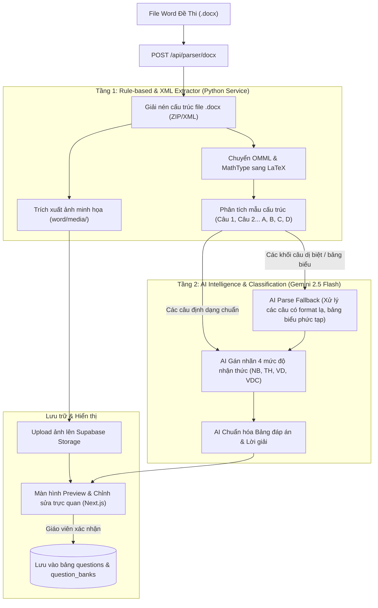

# Kế Hoạch Đặc Tả Chi Tiết: Tính Năng AI Docx Parser (Bóc Tách & Nhập Đề Thi Word Tự Động) — EdTeach

> **Tài liệu đặc tả kỹ thuật & kiến trúc hệ thống (Technical Specification Document)**  
> **Áp dụng cho:** Chương trình GDPT 2018 (Quy chuẩn đề thi tốt nghiệp THPT từ năm 2025 của Bộ GDĐT).  
> **Ngăn xếp công nghệ:** Next.js 16 (Frontend), FastAPI / Python Service (Docx Processing), Gemini 2.5 Flash API (AI Classification & Parsing Fallback), Supabase Storage & Database, KaTeX.

---

## 1. Bối Cảnh Nghiệp Vụ & Bài Toán Cần Giải Quyết

### 1.1. Thực trạng & Nỗi đau của Giáo viên Việt Nam
- **100% giáo viên tại Việt Nam lưu trữ tài liệu đề thi dưới dạng file Microsoft Word (`.docx`).**
- Khi đưa đề lên các hệ thống LMS truyền thống như Moodle, Google Forms, giáo viên phải:
  - Copy/paste từng câu, gõ lại từng đáp án.
  - Chụp màn hình từng công thức Toán/Lý/Hóa rồi upload từng ảnh nhỏ (rất mờ và tốn thời gian).
  - Tốn trung bình **45 - 60 phút** để nhập một đề thi 50 câu.
- **Quy chuẩn đề thi mới từ năm 2025 (GDPT 2018) gồm 3 phần thi:**
  1. **Phần I:** Trắc nghiệm nhiều lựa chọn (4 chọn 1).
  2. **Phần II:** Trắc nghiệm Đúng/Sai (Mỗi câu gồm 4 ý a, b, c, d; tính điểm lũy tiến 0.1 - 0.25 - 0.5 - 1.0).
  3. **Phần III:** Trắc nghiệm trả lời ngắn (Điền số kết quả).

### 1.2. Mục tiêu sản phẩm của EdTeach AI Docx Parser
- Giáo viên chỉ cần **kéo & thả 1 file `.docx` duy nhất**.
- Trong vòng **3 - 8 giây**, hệ thống tự động:
  - Bóc tách toàn bộ câu hỏi theo đúng 3 phần của cấu trúc GDPT 2018.
  - Chuyển đổi mọi công thức toán học (Equation OMML và MathType) sang chuẩn LaTeX `$ ... $` sắc nét.
  - Tự động cắt và trích xuất hình ảnh minh họa đính kèm đúng vào từng câu hỏi.
  - AI tự động đọc hiểu và phân loại 4 mức độ nhận thức: **Nhận biết (NB), Thông hiểu (TH), Vận dụng (VD), Vận dụng cao (VDC)**.
  - Bóc tách bảng đáp án và lời giải chi tiết ở cuối đề.
  - Giáo viên xem trước (Preview), chỉnh sửa nhanh và bấm **"Lưu vào ngân hàng"** chỉ với 1 click.

---

## 2. Kiến Trúc Xử Lý Hybrid (Hybrid Processing Architecture)

Để tối ưu **tốc độ xử lý (< 5s)** và **tiết kiệm 90% chi phí AI Token**, hệ thống áp dụng kiến trúc xử lý 2 tầng (Hybrid):



---

## 3. Pipeline Kỹ Thuật Bóc Tách File `.docx` (Technical Pipeline)

### 3.1. Cấu trúc nội tại của file `.docx`
File `.docx` thực chất là một gói tệp nén ZIP theo chuẩn **Open Packaging Conventions (OPC)**:
- `word/document.xml`: Chứa toàn bộ văn bản, đoạn văn (`<w:p>`), đoạn chạy chữ (`<w:r>`).
- `word/media/`: Thư mục chứa tất cả hình ảnh nhúng (image1.png, image2.jpeg...).
- `word/embeddings/`: Chứa các đối tượng nhúng OLE của MathType (`oleObject1.bin`...).
- `word/_rels/document.xml.rels`: Ánh xạ mã định danh tài nguyên `r:id` với file ảnh tương ứng.

### 3.2. Xử lý Công thức Toán / Lý / Hóa (Math Conversion)
File Word tại Việt Nam thường chứa 2 loại công thức:

#### 1. Công thức Word chuẩn (OMML - Office Math Markup Language)
- Nằm trong thẻ `<m:oMath>` hoặc `<m:oMathPara>`.
- **Giải pháp chuyển đổi:** Dùng bộ chuyển đổi XSLT chính thức của Microsoft (`OMML2MML.XSL`) để biến đổi OMML sang MathML, sau đó dùng thư viện `mathml2latex` chuyển sang chuỗi LaTeX:
  $$\text{OMML XML} \xrightarrow{\text{XSLT}} \text{MathML} \xrightarrow{\text{converter}} \text{LaTeX } (\$E = mc^2\$)$$

#### 2. Công thức MathType (OLE Object)
- Nằm trong thẻ `<w:object>` $\to$ `<o:OLEObject ProgID="Equation.3" ...>`.
- File nhúng được lưu tại `word/embeddings/oleObjectX.bin`.
- **Giải pháp chuyển đổi:**
  - File `.bin` của MathType chứa cấu trúc dữ liệu nhị phân chuẩn MTEF (MathType Equation Format).
  - Sử dụng thư viện `mathtype-converter` (hoặc module Python `oletools`) để trích xuất stream MTEF header và biên dịch sang LaTeX string.

### 3.3. Xử lý Hình ảnh Minh họa (Embedded Media Extraction)
- Khi duyệt qua thẻ `<w:drawing>` hoặc `<w:pict>`, đọc thuộc tính `r:embed="rIdX"`.
- Tra cứu bảng `document.xml.rels` để tìm tên file thực tế trong `word/media/` (ví dụ `image3.png`).
- Upload trực tiếp file ảnh này lên Supabase Storage bucket `question-images` với đường dẫn dạng:
  `questions/[user_id]/[hash].png`
- Thay thế vị trí hình ảnh trong câu hỏi bằng thẻ markdown ``.

---

## 4. Đặc Tả Định Dạng Đề Thi GDPT 2018 (3 Dạng Thức Chuẩn)

Hệ thống parser nhận dạng chính xác 3 dạng thức câu hỏi:

### Dạng 1: Trắc nghiệm 4 lựa chọn (Multiple Choice)
- **Dấu hiệu nhận biết:** Tiêu đề bắt đầu bằng `Câu 1:`, `Câu 1.`, `Bài 1:` và theo sau là 4 phương án `A.`, `B.`, `C.`, `D.`.
- **Cấu trúc dữ liệu đầu ra:**
```json
{
  "type": "single_choice",
  "content": "Một con lắc lò xo gồm vật nặng khối lượng $m = 100\\text{ g}$...",
  "options": [
    {"id": "A", "text": "$2\\text{ N/m}$"},
    {"id": "B", "text": "$4\\text{ N/m}$"},
    {"id": "C", "text": "$20\\text{ N/m}$"},
    {"id": "D", "text": "$40\\text{ N/m}$"}
  ],
  "correct_answer": "C",
  "difficulty_level": 2, // 1: NB, 2: TH, 3: VD, 4: VDC
  "explanation": "Ta có tần số góc $\\omega = \\sqrt{k/m} \\implies k = m\\omega^2 = 20\\text{ N/m}$."
}
```

### Dạng 2: Trắc nghiệm Đúng/Sai (True/False Chùm 4 Ý)
- **Dấu hiệu nhận biết:** Khối câu hỏi có phần dẫn và 4 mệnh đề nhỏ được đánh dấu `a)`, `b)`, `c)`, `d)` hoặc `a.`, `b.`, `c.`, `d.`.
- **Cấu trúc dữ liệu đầu ra:**
```json
{
  "type": "true_false",
  "content": "Cho mạch điện kín gồm nguồn điện có suất điện động $E = 12\\text{ V}$...",
  "sub_items": [
    {"id": "a", "text": "Cường độ dòng điện qua mạch chính là $2\\text{ A}$", "is_correct": true},
    {"id": "b", "text": "Hiệu điện thế giữa hai cực nguồn điện là $10\\text{ V}$", "is_correct": true},
    {"id": "c", "text": "Công suất tiêu thụ mạch ngoài là $24\\text{ W}$", "is_correct": false},
    {"id": "d", "text": "Hiệu suất của nguồn điện đạt $80\\%$", "is_correct": false}
  ],
  "difficulty_level": 3,
  "explanation": "Chi tiết từng ý: a) Đúng vì $I = E/(R+r)...$"
}
```

### Dạng 3: Trắc nghiệm Trả lời ngắn (Short Answer)
- **Dấu hiệu nhận biết:** Câu hỏi yêu cầu học sinh điền kết quả số (ví dụ: *"Giá trị của điện trở là bao nhiêu Ôm?", "Đáp số: ..."*).
- **Cấu trúc dữ liệu đầu ra:**
```json
{
  "type": "short_answer",
  "content": "Một vật dao động điều hòa với biên độ $A = 5\\text{ cm}$. Quãng đường vật đi được trong 1 chu kỳ là bao nhiêu cm?",
  "correct_answer": "20",
  "tolerance": 0.01,
  "difficulty_level": 1,
  "explanation": "Trong 1 chu kỳ vật luôn đi được quãng đường $S = 4A = 4 \\times 5 = 20\\text{ cm}$."
}
```

---

## 5. Thiết Kế API & Schema Dữ Liệu Backend

### 5.1. Endpoint Upload & Parse File Word
- **URL:** `POST /api/parser/docx`
- **Content-Type:** `multipart/form-data`
- **Request Body:**
  - `file`: File `.docx` (kích thước tối đa 25MB).
  - `bank_id`: (Tùy chọn) ID ngân hàng câu hỏi đích để lưu vào.
  - `auto_classify`: `boolean` (Có bật AI gán nhãn độ khó hay không, mặc định `true`).

### 5.2. Response Structure
```json
{
  "success": true,
  "metadata": {
    "file_name": "De_thi_HK1_Vat_Ly_11.docx",
    "total_questions": 40,
    "breakdown": {
      "part_1_single_choice": 18,
      "part_2_true_false": 4,
      "part_3_short_answer": 6
    },
    "difficulty_breakdown": {
      "nhan_biet": 16,
      "thong_hieu": 14,
      "van_dung": 7,
      "van_dung_cao": 3
    },
    "images_extracted": 12,
    "processing_time_ms": 3250
  },
  "questions": [
    /* Danh sách các object câu hỏi theo format JSON ở Mục 4 */
  ]
}
```

---

## 6. Thiết Kế Giao Diện Người Dùng (UI/UX Review & Batch Edit)

Màn hình duyệt đề thi sau khi parse được thiết kế gồm 3 khu vực chính:

```
+---------------------------------------------------------------------------------------+
|  [<= Quay lại]  Nhập đề từ file Word: De_thi_HK1_Vat_Ly_11.docx     [Lưu 40 câu hỏi]  |
+---------------------------------------------------------------------------------------+
|  Thống kê: 40 câu | 18 Trắc nghiệm | 4 Đúng/Sai | 6 Điền số | 12 Hình ảnh | 3.2s     |
|  Ma trận: 16 Nhận biết (Xanh lá) | 14 Thông hiểu (Xanh dương) | 7 VD | 3 VDC (Đỏ)     |
+-----------------------------------+---------------------------------------------------+
|  DANH SÁCH CÂU HỎI (Tree View)    |  CHI TIẾT CÂU HỎI & CHỈNH SỬA (Live KaTeX Preview)|
|                                   |                                                   |
|  [+] PHẦN I: TRẮC NGHIỆM          |  Câu 1: [Nhận biết v] [Trắc nghiệm 4 lựa chọn v]  |
|  * Câu 1 (NB) - Con lắc lò xo...  |  Nội dung:                                        |
|  * Câu 2 (TH) - Điện trở dây...   |  Một con lắc lò xo gồm vật m = $100\text{ g}$...  |
|  * Câu 3 (VD) - Sóng dừng...      |  [Ảnh minh họa: mạch_dien.png] [Thay ảnh] [Xóa]   |
|                                   |                                                   |
|  [+] PHẦN II: ĐÚNG / SAI          |  Các phương án:                                   |
|  * Câu 19 (VD) - Mạch điện kín... |  (o) A. $2\text{ N/m}$                            |
|                                   |  ( ) B. $4\text{ N/m}$                            |
|  [+] PHẦN III: ĐIỀN ĐÁP SỐ        |  (*) C. $20\text{ N/m}$  <-- [ĐÁP ÁN ĐÚNG]        |
|  * Câu 23 (VDC) - Con lắc đơn...  |  ( ) D. $40\text{ N/m}$                            |
|                                   |                                                   |
|  [+] BẢNG ĐÁP ÁN PHÁT HIỆN        |  Lời giải chi tiết:                               |
|  1-C, 2-A, 3-D, 4-B...            |  Áp dụng công thức $\omega = \sqrt{k/m}$...       |
+-----------------------------------+---------------------------------------------------+
```

### Các tiện ích tương tác trực quan:
1. **Live KaTeX Rendering:** Mọi công thức Toán/Lý/Hóa hiển thị đẹp như trang in trong sách giáo khoa ngay lập tức.
2. **Nhấp để sửa nhanh (Inline Editing):** Bấm trực tiếp vào văn bản để chỉnh sửa chính tả hoặc công thức mà không cần mở popup.
3. **Đổi đáp án đúng bằng 1 click:** Chỉ cần click vào radio button cạnh đáp án để đổi đáp án đúng nếu file gốc nhận diện nhầm.
4. **Phím tắt duyệt đề nhanh:** Nhấn `Phím mũi tên xuống` để chuyển câu tiếp theo, nhấn `Ctrl + S` để lưu nhanh.

---

## 7. Phân Tích Chi Phí AI & Tối Ưu Hóa (Unit Economics & Benchmark)

### 7.1. Bảng tính chi phí xử lý 1 đề thi 50 câu:
- **Tầng 1 (Rule-based Regex & XML):** Xử lý bóc tách text + ảnh + MathType: **Hoàn toàn miễn phí (0đ)**, chạy bằng CPU server trong ~0.8 giây.
- **Tầng 2 (Gemini 2.5 Flash API):** Chỉ gửi text câu hỏi để AI phân loại độ khó (NB, TH, VD, VDC) và chuẩn hóa bảng đáp án:
  - Input tokens: ~4.000 tokens (text đề thi 50 câu).
  - Output tokens: ~1.500 tokens (nhãn độ khó + cấu trúc JSON).
  - Giá cước Gemini 2.5 Flash: $0.075 / 1M input tokens, $0.30 / 1M output tokens.
  - **Chi phí cho 1 đề thi 50 câu:**
    $$\text{Chi phí} = \frac{4.000}{1.000.000} \times \$0.075 + \frac{1.500}{1.000.000} \times \$0.30 \approx \$0.00075 \approx \mathbf{19\text{ VNĐ / 1 đề thi!}}$$

> [!NOTE]
> **Kết luận chi phí:** Với mức chi phí chỉ **~19 VNĐ / 1 đề thi**, nếu một giáo viên Pro trả **149.000đ/tháng** và tải lên 50 đề thi mỗi tháng, chi phí API chỉ tốn chưa tới **1.000 VNĐ** (tỉ suất lợi nhuận gộp đạt **> 99%**)!

---

## 8. Lộ Trình Triển Khai Kỹ Thuật (Implementation Milestones)

| Giai đoạn | Nhiệm vụ kỹ thuật | Thời gian dự kiến | Kết quả bàn giao |
| :--- | :--- | :---: | :--- |
| **Giai đoạn 1** | **Docx XML & Math Converter Engine** | 3 ngày | Service Python giải nén docx, convert OMML/MathType sang LaTeX `$ ... $`, trích xuất ảnh. |
| **Giai đoạn 2** | **Structure Parser & AI Classifier** | 3 ngày | Nhận diện 3 dạng thức GDPT 2018 (4 chọn 1, Đúng/Sai, Điền số) + Prompt Gemini gắn nhãn độ khó. |
| **Giai đoạn 3** | **Next.js UI Preview & Batch Edit** | 3 ngày | Giao diện kéo thả file Word, hiển thị KaTeX, bảng kiểm tra lỗi và nút lưu vào ngân hàng. |
| **Giai đoạn 4** | **Kiểm thử trên 50 đề thi thực tế** | 2 ngày | Test với đề thi Toán, Lý, Hóa từ các trường chuyên và Sở GD để tối ưu Regex, đạt độ chính xác > 98%. |

---

## 9. Kết Luận

Tính năng **AI Docx Parser** là tính năng "mở phễu" (Trojan Horse) quan trọng nhất của EdTeach. Một khi giáo viên đã đưa toàn bộ kho tài liệu Word tích lũy hàng chục năm của họ vào hệ thống EdTeach chỉ trong vài phút, họ sẽ bị giữ chân hoàn toàn với nền tảng và sẵn sàng trả phí hàng tháng để sử dụng các tính năng cao cấp tiếp theo (Trộn đề thi, Lớp học trực tuyến LiveKit, Chấm bài AI).
