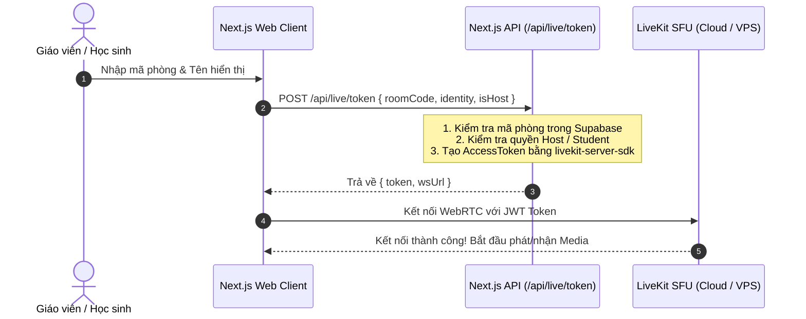
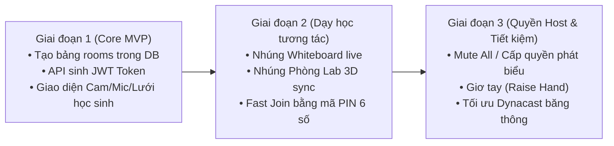

# Kế Hoạch Đặc Tả Chi Tiết: Tính Năng Lớp Học Trực Tuyến (Live Virtual Classroom) — EdTeach

> **Tài liệu tham chiếu thiết kế & kiến trúc kỹ thuật**  
> **Công nghệ lõi:** Next.js 16 (App Router), LiveKit WebRTC SFU, Supabase Database & Auth, Three.js 3D WebGL Labs, Excalidraw Whiteboard.

---

## 1. Tổng Quan & Mục Tiêu Sản Phẩm (Product Overview)

### 1.1. Bối cảnh & Vấn đề
Hiện nay, giáo viên dạy online thường phải dùng song song:
- **Zoom / Google Meet** để gọi video và chia sẻ màn hình.
- Ứng dụng thứ ba (web ngoài) để cho học sinh làm bài tập hoặc xem mô phỏng.

**Hạn chế lớn:**
- Chia sẻ màn hình qua Zoom bị nén mờ, giật lag khung hình (fps thấp 10-15fps), học sinh chỉ được "xem thụ động" chứ không thể tự tay chạm vào mô hình 3D hay viết lên bảng bài giảng.
- Không gắn liền với hệ sinh thái học tập (lịch sử buổi học, điểm danh, bài tập trắc nghiệm, thí nghiệm mô phỏng).

### 1.2. Mục tiêu tính năng Lớp Học Trực Tuyến trên EdTeach
Xây dựng một **phòng học ảo tương tác thời gian thực thế hệ mới**, nơi:
1. **Truyền dẫn video/âm thanh siêu mượt, độ trễ thấp (< 100ms)** giữa giáo viên và 10 - 50 học sinh.
2. **Nhúng trực tiếp Phòng thí nghiệm 3D (Interactive 3D WebGL Labs):** Giáo viên mở bài mô phỏng 3D ngay giữa phòng học, kéo thanh trượt thì toàn bộ học sinh đều thấy mô phỏng chuyển động ở 60fps mượt mà.
3. **Bảng trắng tương tác đồng bộ trực tiếp:** Giáo viên và học sinh cùng viết vẽ giải bài tập, hình học không gian, đồ thị hàm số theo thời gian thực.
4. **Vào học tức thì (Fast Join):** Giáo viên tạo phòng $\to$ gửi link hoặc mã PIN 6 ký tự $\to$ học sinh bấm vào học ngay, không cần đăng ký tài khoản phức tạp.

---

## 2. Kiến Trúc Hệ Thống (System Architecture)

```mermaid
flowchart TD
    subgraph Clients["Lớp Client (Trình duyệt)"]
        Teacher["Giáo viên (Host / Web Browser)"]
        StudentA["Học sinh A (Student / Web Browser)"]
        StudentB["Học sinh B (Student / Web Browser)"]
    end

    subgraph EdTeachServer["EdTeach Server (Next.js 16 + Node.js)"]
        RoomAPI["/api/live/rooms (Quản lý phòng)"]
        TokenAPI["/api/live/token (Cấp quyền JWT LiveKit)"]
    end

    subgraph SupabaseDB["Cơ sở dữ liệu (Supabase PostgreSQL)"]
        TableRooms[("Bảng public.class_rooms")]
        TableParticipants[("Bảng public.room_participants")]
    end

    subgraph LiveKitSFU["Media Server (LiveKit SFU Cluster)"]
        VideoRouter["WebRTC Video/Audio Routing"]
        DataSync["LiveKit Data Channel (Đồng bộ Nét vẽ & Lab 3D)"]
    end

    Teacher -->|1. Tạo phòng & Lưu cấu hình| RoomAPI
    RoomAPI -->|Ghi dữ liệu| TableRooms
    Teacher -->|2. Xin Access Token| TokenAPI
    StudentA -->|2. Xin Access Token qua mã PIN| TokenAPI
    TokenAPI -->|Ký JWT Token| Teacher
    TokenAPI -->|Ký JWT Token| StudentA

    Teacher == WebRTC Media (Publish Cam/Mic/Màn hình) ==> LiveKitSFU
    LiveKitSFU == WebRTC Media (Subscribe) ==> StudentA
    LiveKitSFU == WebRTC Media (Subscribe) ==> StudentB

    Teacher <.. Data Channel (Tọa độ Bút vẽ / Tham số Lab 3D) ..> LiveKitSFU
    LiveKitSFU <.. Data Channel (Đồng bộ tức thời < 30ms) ..> StudentA
```

---

## 3. Thiết Kế Cơ Sở Dữ Liệu (Database Schema — Supabase PostgreSQL)

Thêm migration vào thư mục `supabase/migrations/20261101_virtual_classrooms.sql`:

```sql
-- ========================================================
-- EdTeach - Virtual Classrooms Schema
-- ========================================================

-- 1. BẢNG PHÒNG HỌC (CLASS_ROOMS)
CREATE TABLE IF NOT EXISTS public.class_rooms (
    id UUID PRIMARY KEY DEFAULT gen_random_uuid(),
    code VARCHAR(8) UNIQUE NOT NULL, -- Mã phòng ngắn gọn (vd: "ED-8932")
    title TEXT NOT NULL DEFAULT 'Lớp học trực tuyến',
    description TEXT,
    host_user_id UUID NOT NULL REFERENCES public.users(id) ON DELETE CASCADE,
    
    -- Trạng thái phòng: 'waiting' (chờ), 'active' (đang diễn ra), 'ended' (đã kết thúc)
    status TEXT NOT NULL DEFAULT 'waiting' CHECK (status IN ('waiting', 'active', 'ended')),
    
    -- Cấu hình phòng học (JSONB)
    settings JSONB NOT NULL DEFAULT '{
        "mute_on_entry": true,
        "allow_student_mic": true,
        "allow_student_cam": true,
        "allow_student_whiteboard": false,
        "allow_chat": true,
        "max_participants": 50
    }'::jsonb,
    
    -- Dữ liệu nhúng hiện tại trong phòng (Lab 3D slug hoặc Whiteboard ID)
    active_presentation JSONB DEFAULT NULL,
    
    created_at TIMESTAMPTZ NOT NULL DEFAULT timezone('utc'::text, now()),
    started_at TIMESTAMPTZ,
    ended_at TIMESTAMPTZ
);

-- 2. BẢNG THÀNH VIÊN THAM GIA (ROOM_PARTICIPANTS)
CREATE TABLE IF NOT EXISTS public.room_participants (
    id UUID PRIMARY KEY DEFAULT gen_random_uuid(),
    room_id UUID NOT NULL REFERENCES public.class_rooms(id) ON DELETE CASCADE,
    user_id UUID REFERENCES public.users(id) ON DELETE SET NULL, -- NULL nếu học sinh vào nhanh bằng tên
    display_name TEXT NOT NULL,
    role TEXT NOT NULL DEFAULT 'student' CHECK (role IN ('host', 'co-host', 'student')),
    is_hand_raised BOOLEAN NOT NULL DEFAULT false,
    joined_at TIMESTAMPTZ NOT NULL DEFAULT timezone('utc'::text, now()),
    left_at TIMESTAMPTZ
);

-- 3. CHỈ MỤC TỐI ƯU TRUY VẤN
CREATE INDEX IF NOT EXISTS idx_class_rooms_code ON public.class_rooms(code);
CREATE INDEX IF NOT EXISTS idx_class_rooms_host ON public.class_rooms(host_user_id);
CREATE INDEX IF NOT EXISTS idx_class_rooms_status ON public.class_rooms(status);
CREATE INDEX IF NOT EXISTS idx_room_participants_room_id ON public.room_participants(room_id);

-- 4. BẢO MẬT HÀNG (RLS)
ALTER TABLE public.class_rooms ENABLE ROW LEVEL SECURITY;
ALTER TABLE public.room_participants ENABLE ROW LEVEL SECURITY;

-- Bất kỳ ai có mã phòng đều có thể xem thông tin phòng để tham gia
CREATE POLICY "Public read active rooms by code"
    ON public.class_rooms FOR SELECT
    USING (status != 'ended');

-- Giáo viên có quyền tạo và chỉnh sửa phòng của mình
CREATE POLICY "Hosts can manage their own rooms"
    ON public.class_rooms FOR ALL
    USING (auth.uid() = host_user_id);

CREATE POLICY "Anyone can join room participants"
    ON public.room_participants FOR INSERT
    WITH CHECK (true);

CREATE POLICY "View participants in room"
    ON public.room_participants FOR SELECT
    USING (true);
```

---

## 4. Đặc Tả Tính Năng Chi Tiết (Functional Specifications)

### 4.1. Khởi tạo & Tham gia phòng học (Fast Join)
- **Dành cho Giáo viên:**
  - Nhấn nút "Tạo lớp học mới" tại menu Dashboard.
  - Tùy chỉnh: Tên lớp, tự động tắt mic học sinh khi vào, cho phép học sinh vẽ bảng.
  - Hệ thống cấp:
    - **Link mời:** `https://edteach.vn/live/ED-8932`
    - **Mã PIN 6 số:** `ED-8932`
- **Dành cho Học sinh:**
  - Cách 1: Click trực tiếp vào link giáo viên gửi.
  - Cách 2: Vào trang `edteach.vn/live` $\to$ Nhập mã `ED-8932` và điền "Họ tên của bạn".
  - Không bắt buộc đăng ký tài khoản rườm rà.

### 4.2. Khung truyền hình trực tiếp (LiveKit Video Grid)
- Sử dụng các component từ thư viện chính thức `@livekit/components-react`.
- Tự động chuyển đổi layout:
  - **Chế độ Gallery:** Lưới hiển thị các camera học sinh (1x1, 2x2, 3x3, 4x4).
  - **Chế độ Speaker / Presentation:** Khi giáo viên nói hoặc mở bài giảng, màn hình giáo viên/bài giảng chiếm 80% diện tích trung tâm, camera học sinh xếp gọn thành dải nhỏ ở cạnh trên hoặc cạnh phải.
- **Tối ưu băng thông tự động (Simulcast / Dynacast):** LiveKit tự động hạ chất lượng video của học sinh ở ô nhỏ để tiết kiệm 70% băng thông của phòng học.

### 4.3. Công cụ dạy học tương tác độc quyền (EdTeach Exclusive)

#### A. Nhúng trực tiếp Phòng thí nghiệm 3D (3D Labs Integration)
- Giáo viên nhấn biểu tượng **"Thí nghiệm 3D"** trên thanh công cụ $\to$ Chọn 1 trong 54 bài Lab đã Việt hóa (ví dụ: *Kiểm chứng định luật bảo toàn cơ năng, Lực hướng tâm, Tự cảm và Foucault, Chuyển động ném ngang*...).
- **Cơ chế đồng bộ qua LiveKit Data Channel:**
  - Không truyền video màn hình nặng nề.
  - Thay vào đó, iframe Lab 3D chạy trực tiếp bằng GPU của máy học sinh. Giáo viên thay đổi tham số (kéo thanh trượt con chạy, đóng khóa K, thả vật rơi), vị trí góc camera 3D $\to$ gửi gói tin JSON siêu nhẹ (< 1KB) qua `LiveKit Data Channel` $\to$ màn hình của 50 học sinh chuyển động đồng thời với độ trễ < 30ms!

#### B. Bảng trắng tương tác thời gian thực (Live Synchronized Whiteboard)
- Nhúng component Whiteboard sẵn có của EdTeach.
- Giáo viên có 2 chế độ:
  - **Chế độ Giảng bài (View Only for Students):** Chỉ giáo viên được viết/vẽ; học sinh xem nét vẽ xuất hiện tức thì.
  - **Chế độ Cùng giải bài (Collaborative Mode):** Giáo viên chỉ định 1 hoặc nhiều học sinh "lên bảng" để cùng vẽ hình, viết công thức, chấm điểm trực tiếp.

#### C. Quyền quản trị lớp học của Giáo viên (Host Controls)
- **Tắt tiếng tất cả (Mute All):** Tắt mic toàn bộ lớp khi giáo viên bắt đầu giảng lý thuyết.
- **Giơ tay phát biểu (Raise Hand):** Học sinh nhấn nút "Giơ tay" $\to$ biểu tượng bàn tay vàng nổi bật trên khung camera và danh sách $\to$ Giáo viên nhấn "Cấp quyền phát biểu" để học sinh mở mic.
- **Khóa phòng (Lock Room):** Ngăn người lạ vào sau khi đã đủ sĩ số.

---

## 5. Quy Trình Cấp Mã Truy Cập (Token Flow & API Endpoints)



### Mã nguồn API mẫu tạo Token (`src/app/api/live/token/route.ts`):
```typescript
import { AccessToken } from "livekit-server-sdk";
import { NextRequest, NextResponse } from "next/server";

export async function POST(req: NextRequest) {
  try {
    const { roomCode, participantName, isHost } = await req.json();

    if (!roomCode || !participantName) {
      return NextResponse.json({ error: "Thiếu thông tin" }, { status: 400 });
    }

    const apiKey = process.env.LIVEKIT_API_KEY!;
    const apiSecret = process.env.LIVEKIT_API_SECRET!;
    const wsUrl = process.env.NEXT_PUBLIC_LIVEKIT_WS_URL!;

    const at = new AccessToken(apiKey, apiSecret, {
      identity: `${participantName}-${Date.now()}`,
      name: participantName,
    });

    // Cấp quyền trong phòng
    at.addGrant({
      room: roomCode,
      roomJoin: true,
      canPublish: isHost ? true : false, // Học sinh mặc định chỉ nghe, giơ tay mới cấp phát
      canSubscribe: true,
      canPublishData: true, // Cho phép truyền dữ liệu bảng vẽ / lab 3D
      roomAdmin: isHost ? true : false,
    });

    return NextResponse.json({
      token: await at.toJwt(),
      wsUrl,
    });
  } catch (error: any) {
    return NextResponse.json({ error: error.message }, { status: 500 });
  }
}
```

---

## 6. Bảng Tính Chi Phí Vận Hành (Cost & Budgeting)

### 6.1. Bảng so sánh 2 phương án hạ tầng

| Tiêu chí | Phương án A: LiveKit Cloud | Phương án B: Self-Hosted LiveKit (Docker trên VPS) |
| :--- | :--- | :--- |
| **Độ khó cài đặt** | **Rất dễ (5 phút):** Chỉ cần copy API Key/Secret vào `.env` | **Trung bình:** Cài Docker, mở cổng UDP WebRTC, cấu hình SSL Let's Encrypt |
| **Gói miễn phí** | **Miễn phí 50 GB / tháng** (~1.000 participant-minutes) | Mã nguồn mở miễn phí 100% |
| **Chi phí cố định** | 0 VNĐ | Giá thuê 1 VPS Hetzner / Vultr: **~120.000 VNĐ / tháng** |
| **Băng thông đi kèm** | Trả theo dung lượng vượt | **20.000 GB (20 TB) miễn phí / tháng** |
| **Phù hợp giai đoạn** | **Giai đoạn thử nghiệm, làm tính năng, demo** | **Giai đoạn vận hành thực tế cho trường học / dạy thêm** |

### 6.2. Dự toán chi phí thực tế theo quy mô sử dụng

| Kịch bản sử dụng | Thời lượng trong tháng | Chi phí LiveKit Cloud | Chi phí Tự Host VPS Hetzner |
| :--- | :--- | :---: | :---: |
| **Thử nghiệm & Phát triển** | 5 buổi x 5 học sinh x 30 phút = 750 phút | **0 VNĐ (Trong Free Tier)** | **~120.000 VNĐ** |
| **1 Lớp dạy thêm (15 học sinh)** | 12 buổi x 15 học sinh x 90 phút = 16.200 phút | ~1.900.000 VNĐ | **Cố định ~120.000 VNĐ** (chưa dùng hết 2% băng thông VPS) |
| **10 Lớp dạy (150 học sinh)** | 120 buổi học / tháng | ~19.000.000 VNĐ | **Cố định ~250.000 VNĐ** (Nâng cấp VPS 4 Core / 8GB RAM) |

> [!TIP]
> **Khuyến nghị chiến lược:**
> 1. Sử dụng **LiveKit Cloud (gói Free)** trong giai đoạn code tính năng và chạy thử nghiệm ban đầu (chi phí **0đ**).
> 2. Khi bắt đầu đưa tính năng vào dạy chính thức cho các lớp học sinh, triển khai LiveKit Server bằng Docker lên một VPS giá rẻ (như Hetzner Cloud CPX21 ~150k/tháng) để có **20TB băng thông**, phục vụ hàng chục lớp học đồng thời với chi phí cố định cực rẻ.

---

## 7. Lộ Trình Triển Khai Kỹ Thuật (Implementation Roadmap)



- **Giai đoạn 1 (Core Video Room MVP - Dự kiến 4 ngày):**
  - Cài đặt `livekit-server-sdk`, `@livekit/components-react`.
  - Tạo bảng `class_rooms` trong Supabase.
  - Xây dựng trang `/live` (danh sách phòng) và trang `/live/[code]` (phòng họp cơ bản có camera, mic, chia sẻ màn hình).
- **Giai đoạn 2 (Interactive Teaching Suite - Dự kiến 5 ngày):**
  - Tích hợp Bảng vẽ Whiteboard vào giữa màn hình phòng học, đồng bộ nét vẽ qua LiveKit Data Channel.
  - Tích hợp 54 bài Lab 3D WebGL vào phòng học, gửi dữ liệu thanh trượt/thao tác qua Data Channel.
  - Xây dựng giao diện Fast Join cho học sinh không cần đăng nhập.
- **Giai đoạn 3 (Host Controls & Polish - Dự kiến 3 ngày):**
  - Bổ sung nút "Tắt tiếng tất cả" (Mute all), duyệt học sinh vào phòng, nút "Giơ tay phát biểu".
  - Kiểm thử tải (stress test) trên mạng 4G/WiFi học sinh yếu để tinh chỉnh Dynacast.
- **Giai đoạn 4 (Nâng cao - Tùy chọn sau này):**
  - Ghi hình buổi học (Recording) lưu vào Cloudflare R2 / AWS S3.
  - Điểm danh tự động và xuất file Excel thời gian tham gia của từng học sinh.

---

## 8. Kết Luận & Quyết Định

Tính năng Lớp học trực tuyến của EdTeach có lợi thế cạnh tranh áp đảo so với các nền tảng họp trực tuyến thông thường (Zoom/Meet/Teams) nhờ sự **tích hợp sâu với Phòng thí nghiệm 3D và Bảng vẽ tương tác**. 

Toàn bộ kiến trúc và thiết kế dữ liệu đã sẵn sàng; khi bạn quyết định triển khai, chúng ta có thể kích hoạt lộ trình này ngay lập tức!
