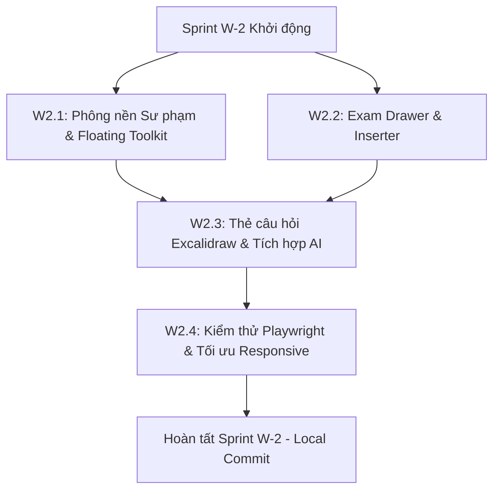

# PLAN — TÍCH HỢP LÀM ĐỀ & TRỢ GIẢNG SỐ TRÊN BẢNG TRẮNG (WHITEBOARD EXAM STUDIO)

> **Ngày lập:** 31/10/2026  
> **Trạng thái:** ALIGNED VIA /GRILL-ME — SẴN SÀNG TRIỂN KHAI SPRINT W-2  
> **Phạm vi:** Trang Bảng vẽ cá nhân `/whiteboard/[id]`, component `whiteboard-editor.tsx`, tích hợp ngân hàng đề thi cá nhân & chợ đề, trợ giảng AI tại chỗ, bộ phông nền bảng sư phạm và bộ công cụ bục giảng nổi.

---

## 1. MỤC TIÊU DỰ ÁN

Biến không gian Bảng vẽ cá nhân (`/whiteboard/[id]`) từ một canvas vẽ tự do thông thường thành **Bục Giảng Số Tương Tác Toàn Năng (Interactive Whiteboard Studio)** cho giáo viên đứng lớp:
1. **Làm đề & Chữa đề trực tiếp trên Bảng:** Giáo viên có thể duyệt kho đề thi (cá nhân và đề mua từ Chợ), bấm 1 chạm để chèn câu hỏi chuẩn ma trận phông lớn lên canvas Excalidraw, viết phấn/bút giải chi tiết ngay bên cạnh.
2. **Khắc phục triệt để cảm giác "vẽ chay":** Cung cấp 5 phông nền sư phạm chân thực (Bảng xanh phấn trắng, Bảng đen, Giấy kẻ ô ly, Giấy kẻ ngang giáo án, Bảng trắng văn phòng) tự động chuyển đổi bộ màu mực phấn tương ứng.
3. **Bộ công cụ Bục Giảng Nổi tại chỗ:** Đồng hồ đếm ngược ⏱️ 02:00 cho học sinh làm bài nháp, Bút laser chỉ bảng trên máy chiếu, Chế độ Zen Fullscreen tối đa diện tích giảng dạy.
4. **Vũ khí AI ngay trên Thẻ câu hỏi:** Bấm nút trực tiếp trên thẻ đề thi để AI *Đẻ câu hỏi tương tự* hoặc *Bẻ nhỏ câu khó 3 bước* chèn thẳng kế bên nét vẽ của thầy cô.

---

## 2. KẾT QUẢ PHỎNG VẤN THIẾT KẾ (/GRILL-ME CONSENSUS)

| Nhánh quyết định | Quyết định thống nhất | Lý do sư phạm & kỹ thuật |
|---|---|---|
| **Mô hình làm đề trên Whiteboard** | **Ngăn kéo (Drawer) "Kho Đề & Chèn Câu Hỏi"** | Giữ không gian canvas Excalidraw rộng rãi nhất có thể, giáo viên kéo drawer ra khi cần chọn câu hỏi, chèn xong drawer tự thu gọn để nhường chỗ viết bảng. |
| **Hình thức câu hỏi trên canvas** | **Thẻ câu hỏi trực quan chuẩn sư phạm** | Câu hỏi được đóng gói thành khối Card thẩm mỹ cao (khung bo góc, huy hiệu môn/khối/độ khó, phông chữ lớn sắc nét cho máy chiếu), có nút gập mở Gợi ý / Lời giải chi tiết. |
| **Nguồn dữ liệu đề thi** | **Đầy đủ cả 2 nguồn: Đề cá nhân & Đề đã mua từ Chợ** | Tận dụng tối đa hệ sinh thái EdTeach: giáo viên soạn đề trong Studio hoặc mua đề chất lượng cao từ Chợ đề thi đều có thể mang lên Bảng trắng giảng dạy ngay. |
| **Bộ công cụ bổ trợ trên trang** | **1. Phông nền Bảng Sư Phạm** **2. Bục Giảng Nổi (Timer, Laser, Fullscreen)** **3. AI Live Cloner & Scaffolding** | Bộ 3 tính năng hoàn thiện trải nghiệm đứng lớp thực tế của giáo viên Việt Nam, tương thích hoàn hảo cả trên máy chiếu lớp học lẫn màn hình tương tác thông minh (Smart Board). |

---

## 3. KIẾN TRÚC & THIẾT KẾ CHI TIẾT

### Module 1: Ngăn kéo Kho Đề Thi (Exam Drawer & Inserter)
* **Vị trí UI:** Nút kích hoạt `"📚 Chèn Đề Thi"` trên Topbar của `whiteboard-editor.tsx` (cạnh nút Mẫu vẽ STEM).
* **Giao diện Drawer:**
  * Tabs chuyển đổi: **"Đề của tôi"** (`public.exams`) và **"Đề đã mua từ Chợ"** (`marketplace_purchases` join `marketplace_items`).
  * Bộ lọc nhanh: Ô tìm kiếm theo tên đề, dropdown chọn Môn học và Khối lớp.
  * Danh sách câu hỏi: Hiển thị tóm tắt câu hỏi, độ khó, dạng trắc nghiệm / đúng sai / trả lời ngắn.
  * Nút hành động:
    * **"Chèn câu này vào Bảng"**: Thêm thẻ câu hỏi vào tọa độ trống trung tâm màn hình hiện tại.
    * **"Chèn kèm Lời giải"**: Thêm cả câu hỏi và khối đáp án chi tiết.
    * **"Chèn toàn bộ đề (Dạng trang bài tập)"**: Sắp xếp nối tiếp các câu hỏi có khoảng trống để giải lần lượt.

### Module 2: Thẻ Câu Hỏi Chuẩn Sư Phạm Trên Excalidraw
* **Cơ chế biểu diễn:** Tạo các Excalidraw Elements phối hợp (Khung hình chữ nhật bo góc viền kép, văn bản tiêu đề phông chữ to rõ, các khối phương án A-B-C-D với màu sắc tương phản cao).
* **Nút hành động nhanh trên thẻ:**
  * 💡 **Bật/Tắt Lời giải chi tiết:** Sinh thêm khối văn bản lời giải bên dưới câu hỏi.
  * ⏱️ **Đẻ câu tương tự (Live Cloner):** Gọi API `/api/ai/live-clone` tạo câu hỏi biến thể cùng dạng nhưng đổi số liệu, chèn ngay bên phải câu gốc kèm đồng hồ 2 phút.
  * 🪜 **Bẻ nhỏ câu khó (Scaffolding):** Gọi API `/api/ai/scaffold` tách 3 câu hỏi dẫn dắt (Giả thiết -> Phương trình -> Biện luận).

### Module 3: Bộ 5 Phông Nền Bảng Sư Phạm (Classroom Board Themes)
Thêm menu chọn nền bảng trên Topbar:
1. **Bảng Xanh Lớp Học (Classroom Green Board):** Nền `#0d382e` / `#064e3b`, nét phấn mặc định: Trắng `#ffffff`, Vàng phấn `#fef08a`, Cam phấn `#fed7aa`.
2. **Bảng Đen Truyền Thống (Matte Blackboard):** Nền `#18181b` / `#0f172a`, nét phấn trắng sữa siêu nét.
3. **Giấy Kẻ Ô Ly Học Sinh (French Ruled / Grid Paper):** Nền trắng kem `#fefefe` với lưới ca-rô xanh nhạt 5x5mm, nét mực bút máy xanh tím `#2563eb` và đỏ `#dc2626`.
4. **Giấy Kẻ Ngang Giáo Án (Lined Notebook):** Nền `#fafaf9` kẻ dòng song song cách đều 8mm.
5. **Bảng Trắng Văn Phòng Hiện Đại (White Canvas):** Nền sạch `#ffffff` mặc định.

### Module 4: Bộ Công Cụ Bục Giảng Nổi (Floating Classroom Toolkit)
Widget nổi có thể kéo thả (Draggable floating bar) nằm ở góc dưới màn hình:
* ⏱️ **Đồng hồ đếm ngược (Countdown Timer):**
  * Nút chọn nhanh: 1 phút, 2 phút, 5 phút hoặc tự chỉnh.
  * Nút Play/Pause/Reset.
  * Hiển thị số to rõ, đổi màu đỏ cam khi còn dưới 30 giây, chuông báo tinh tế khi hết giờ.
* 🔴 **Bút Laser Chỉ Bảng (Virtual Laser Pointer):**
  * Chuyển con trỏ chuột thành chấm đỏ phát quang kèm quầng sáng.
  * Để lại vệt sáng tạm thời mờ dần sau 1.2 giây giúp học sinh dưới lớp tập trung theo dõi giáo viên đang chỉ vào công thức nào.
* 📺 **Chế độ Zen Fullscreen:**
  * Ẩn toàn bộ header, thanh điều hướng và các panel phụ, chỉ giữ lại canvas Excalidraw và widget nổi. Bấm phím `Esc` để thoát.

---

## 4. KẾ HOẠCH TRIỂN KHAI CHI TIẾT (SPRINT W-2)

### Nhiệm vụ cụ thể:

| Task ID | Nội dung thực hiện | Tệp can thiệp | Kết quả kỳ vọng |
|---|---|---|---|
| **W2.1** | Xây dựng bộ 5 phông nền Sư phạm & lưu vào `app_state` | `frontend/src/lib/whiteboard/board-themes.ts` `frontend/src/components/whiteboard/whiteboard-editor.tsx` | Đổi nền bảng xanh/đen/ô ly 1 chạm, tự động đổi màu nét vẽ tương ứng |
| **W2.2** | Xây dựng Floating Classroom Toolkit (Timer đếm ngược + Zen Fullscreen + Laser) | `frontend/src/components/whiteboard/floating-classroom-tools.tsx` | Widget nổi kéo thả được, Timer 2 phút chạy mượt mà |
| **W2.3** | Xây dựng Exam Drawer lấy dữ liệu từ Đề cá nhân & Đề đã mua | `frontend/src/components/whiteboard/exam-drawer.tsx` `frontend/src/lib/api/exams.ts` | Duyệt danh sách đề thi, tìm kiếm câu hỏi, xem trước chi tiết |
| **W2.4** | Triển khai thuật toán chèn thẻ câu hỏi và kết nối AI Live Cloner / Scaffold | `frontend/src/lib/whiteboard/question-to-excalidraw.ts` `frontend/src/components/whiteboard/whiteboard-editor.tsx` | Câu hỏi xuất hiện dưới dạng Card sắc nét trên Excalidraw, bấm đẻ câu tương tự sinh ngay bên cạnh |
| **W2.5** | Kiểm thử Next.js build 102/102 & Playwright visual test trên Desktop / Máy chiếu | `scratch/test_whiteboard_exam_studio.py` | 0 lỗi TypeScript, giao diện sắc nét, lưu dữ liệu bền vững |

---

## 5. RÀNG BUỘC & CAM KẾT CHẤT LƯỢNG

1. **Tuyệt đối tuân thủ chỉ thị người dùng:** **CHỈ LOCAL GIT COMMIT, KHÔNG PUSH CODE** (`git push`).
2. **Không phá vỡ cấu trúc cũ:** Toàn bộ cơ chế lưu trữ hiện tại (Dual-persistence: LocalStorage + Supabase debounce 2.5s) và sinh WebP Thumbnail tự động của Sprint W-1 được bảo toàn 100%.
3. **Hiệu năng cao:** Không làm đơ Excalidraw khi chèn câu hỏi; các nét vẽ và thẻ câu hỏi được nhóm (group) logic để giáo viên di chuyển dễ dàng trên bảng.
